# Lab6Web — Praktikum 6: JavaScript DOM dan Event Handling

**Mata Kuliah:** Pemrograman Web (Pertemuan 7)
**Nama:** Alfy Ramadhan
**NIM:** 312510298
**Program Studi:** Teknik Informatika — Universitas Pelita Bangsa

## A. Tujuan Praktikum
1. Memahami DOM sebagai representasi dokumen HTML yang dapat diakses melalui JavaScript.
2. Menggunakan id, class, dan selector CSS untuk memilih elemen HTML.
3. Mengubah teks, atribut, kelas CSS, dan gaya elemen melalui JavaScript.
4. Menangani event pengguna menggunakan `addEventListener()`.
5. Membuat validasi form dan menampilkan pesan sesuai kondisi input.
6. Mengembangkan halaman interaktif dengan minimal tiga fungsi yang berjalan benar.

## B. Struktur File
```
Lab6Web/
├── lab6_dom_event/                    # Latihan 1–6 + Eksperimen
│   ├── index.html
│   ├── style.css
│   ├── script.js
│   ├── eksperimen5_tanpa_defer.html   # demo Eksperimen 5
│   ├── eksperimen5_dengan_defer.html  # demo Eksperimen 5
│   └── eksperimen5.js
├── mini_project_workshop/             # Mini Project: Form Pendaftaran Workshop
│   ├── index.html
│   ├── style.css
│   └── script.js
├── screenshots/
└── README.md
```

## C. Cara Menjalankan
1. Buka folder `Lab6Web` di Visual Studio Code.
2. Buka `lab6_dom_event/index.html` untuk Latihan 1–6, atau `mini_project_workshop/index.html` untuk Mini Project, di browser (klik dua kali, atau klik kanan → *Open with Live Server*).
3. Buka Developer Tools dengan **F12** (tab *Console*) untuk memeriksa error.

`script.js` dimuat pada `<head>` dengan atribut `defer`, sehingga JavaScript dijalankan setelah seluruh HTML selesai diparsing dan semua elemen sudah tersedia.

---

## D. Langkah Kerja dan Hasil

### Latihan 1 — Mengubah teks dengan DOM
**Langkah:** Elemen `#judul` dan `#pesan` dipilih dengan `document.getElementById()`, lalu isinya diganti dengan `textContent`.
**Hasil:** Judul berubah dari "Latihan DOM" menjadi "Belajar JavaScript DOM", dan paragraf dari "Belum ada tindakan." menjadi "Konten berhasil diubah oleh JavaScript."

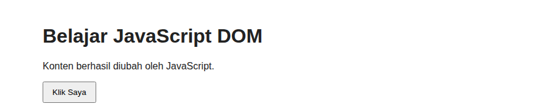

*Bukti screenshot: `latihan_1.png`*

### Latihan 2 — Event click
**Langkah:** Tombol `#tombolAksi` diberi `addEventListener("click", ...)`. Setiap kali diklik, paragraf `#pesan` diperbarui dengan `"Tombol diklik pada " + new Date().toLocaleTimeString()`.
**Hasil:** Setiap klik memperbarui teks dengan jam saat tombol ditekan.

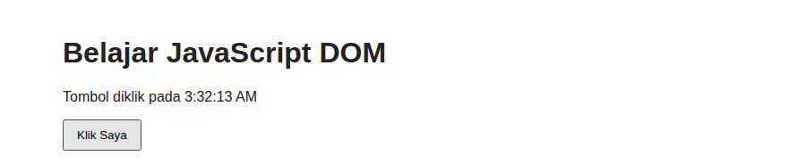

*Bukti screenshot: `latihan_2.png`*

### Latihan 3 — Mengubah kelas dan gaya CSS
**Langkah:** Aturan `.highlight` dan `.teks-besar` ditambahkan ke `style.css`. Tombol `#tombolGaya` memanggil `classList.toggle()` untuk kedua kelas pada paragraf `#teksGaya`.
**Hasil:** Klik pertama menambahkan kelas `highlight` dan `teks-besar` (teks biru dengan latar dan huruf lebih besar), klik kedua menghapus keduanya.

**Perbedaan `classList`:**
| Method | Fungsi |
|--------|--------|
| `classList.add("x")` | Menambahkan kelas `x` (tidak ada efek jika sudah ada). |
| `classList.remove("x")` | Menghapus kelas `x`. |
| `classList.toggle("x")` | Menambahkan kelas jika belum ada dan menghapusnya jika sudah ada. |

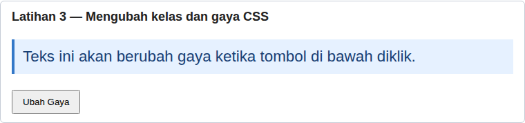

*Bukti screenshot: `latihan_3.png`*

### Latihan 4 — Event input dan penghitung karakter
**Langkah:** Input `#namaInput` diberi event `input`. Setiap perubahan isi memperbarui `#jumlahKarakter` dengan `namaInput.value.length`.

| Pengujian | Hasil |
|-----------|-------|
| Mengetik "Alfy" | Jumlah karakter: 4 |
| Menghapus seluruh isi | Jumlah karakter: 0 |
| Mengisi "Alfy Ramadhan" | Jumlah karakter: 13 |
| Mengetik lebih dari 40 karakter | Berhenti di 40 (dibatasi `maxlength="40"`) |

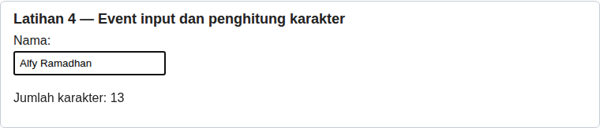

*Bukti screenshot: `latihan_4.png`*

### Latihan 5 — Validasi form pendaftaran
**Langkah:** Form `#formPendaftaran` (nama, email, usia) memakai event `submit` dengan `event.preventDefault()`. Data diperiksa berurutan: nama, email (pola regex), lalu usia (bilangan bulat 17–100). Form diberi `novalidate` agar validasi dilakukan oleh JavaScript, bukan tooltip bawaan browser.

| Kondisi | Hasil |
|---------|-------|
| Semua kosong | Nama wajib diisi. |
| Nama kosong / hanya spasi | Nama wajib diisi. |
| Nama 2 huruf ("Al") — Eksperimen 2 | Nama minimal terdiri dari 3 karakter. |
| Email tidak valid ("alfy@" atau "alfy.com") | Masukkan email yang valid. |
| Usia di bawah 17 (16) | Usia harus berupa bilangan bulat 17–100. |
| Usia di atas 100 (101) | Usia harus berupa bilangan bulat 17–100. |
| Usia kosong atau desimal (20.5) | Usia harus berupa bilangan bulat 17–100. |
| Usia batas 17 dan 100 | Validasi berhasil. Form siap diproses. |
| Semua valid | Validasi berhasil. Form siap diproses. (form dikosongkan dengan `form.reset()`) |

**Semua kosong (tidak valid)**
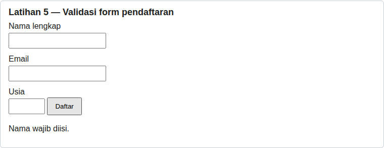

*Bukti screenshot: `latihan_5_kosong.png`*

**Email tidak valid**
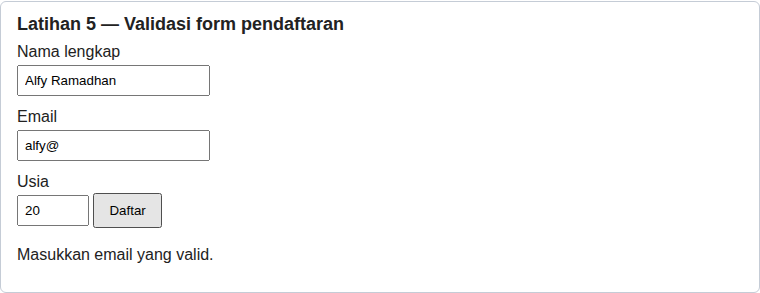

*Bukti screenshot: `latihan_5_email.png`*

**Usia di bawah 17**
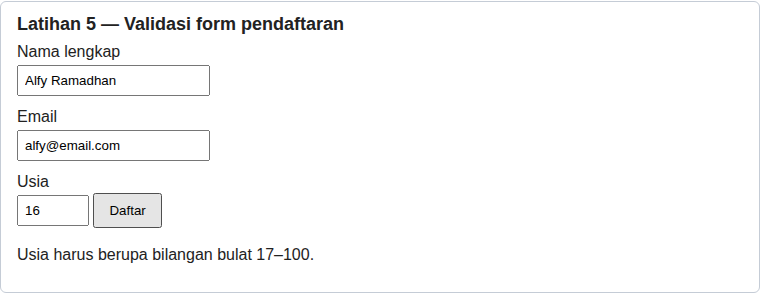

*Bukti screenshot: `latihan_5_usia.png`*

**Semua valid**
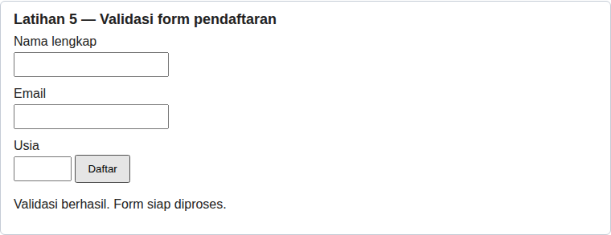

*Bukti screenshot: `latihan_5_valid.png`*

### Latihan 6 — Daftar tugas sederhana (To-do List)
**Langkah:** Tombol *Tambah* membuat elemen `<li>` baru dengan `document.createElement()`. Tiap item berisi teks tugas (`<span>`) dan tombol *Tandai selesai* yang men-*toggle* kelas `selesai` (teks dicoret). Teks pengguna dimasukkan dengan `textContent`, sehingga tampil sebagai teks dan bukan markup HTML.

| Pengujian | Hasil |
|-----------|-------|
| Tambah dengan input kosong atau spasi | Tulis tugas terlebih dahulu. |
| Tambah tugas | Item muncul, input dikosongkan dan fokus kembali ke input, pesan "Tugas ditambahkan." |
| Klik *Tandai selesai* | Teks dicoret dan tombol menjadi "Batalkan selesai" |
| Klik *Batalkan selesai* | Coretan hilang dan tombol kembali "Tandai selesai" |
| Memasukkan `<b>tebal</b>` | Tampil sebagai teks apa adanya, tidak dieksekusi sebagai HTML |

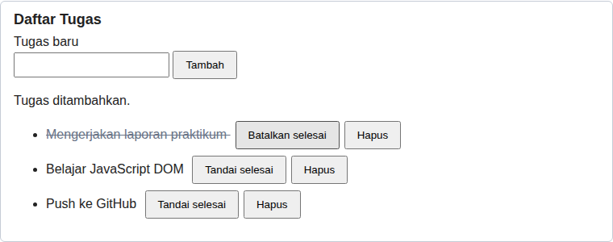

*Bukti screenshot: `latihan_6.png`*

---

## E. Mini Project — Form Pendaftaran Workshop
Folder `mini_project_workshop` (kode dipisah ke `index.html`, `style.css`, dan `script.js`).

**Fungsi interaktif yang dibuat (lebih dari tiga):**
1. **Validasi form** (event `submit`): nama (wajib, minimal 3 karakter), email (wajib dan format valid), dan pilihan sesi (wajib). Pesan kesalahan tampil di bawah kolom yang bermasalah, kolom diberi garis merah, dan fokus pindah ke kolom pertama yang salah.
2. **Penghitung karakter** (event `input`): jumlah karakter catatan diperbarui langsung dan dibatasi 150 karakter.
3. **Ringkasan input langsung** (event `input` dan `change`): nama, email, dan sesi ditampilkan seketika saat diisi.
4. **Informasi sesi terpilih** (event `change` pada dropdown, Eksperimen 3): menampilkan sesi yang dipilih.
5. **Pesan sukses** setelah semua data valid, lalu form dikosongkan.
6. **Tombol Reset** (event `click`): mengosongkan semua input, pesan, ringkasan, dan penghitung.

Pesan kesalahan hilang otomatis saat pengguna mulai memperbaiki kolom tersebut. Tampilan responsif: pada layar ≤ 480px tombol menjadi selebar layar dan kartu menyesuaikan, dan telah diuji tanpa scroll horizontal pada lebar 375px dan 320px.

| Pengujian | Hasil |
|-----------|-------|
| Semua kosong | "Nama wajib diisi.", "Email wajib diisi.", "Pilih salah satu sesi workshop." |
| Nama "Al" | Nama minimal terdiri dari 3 karakter. |
| Email "bukan-email" | Masukkan email yang valid, misalnya nama@email.com. |
| Hanya sesi belum dipilih | Pilih salah satu sesi workshop. |
| Memilih sesi | Tampil "Sesi yang dipilih: ..." dan ringkasan ikut berubah |
| Semua valid | "Pendaftaran berhasil! Terima kasih, Alfy Ramadhan. Anda terdaftar pada Sesi 2: JavaScript DOM (Sabtu, 13.00)." lalu form kosong |
| Klik Reset | Semua kembali ke keadaan awal |

**Kondisi tidak valid (semua kosong)**
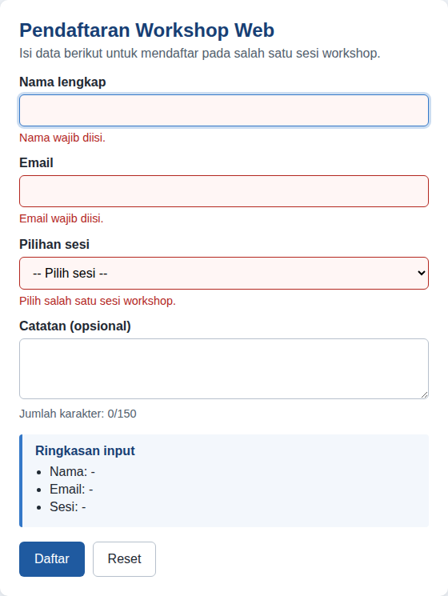

*Bukti screenshot: `mini_project_1_kosong.png`*

**Pengisian dengan ringkasan, penghitung karakter, dan sesi terpilih**
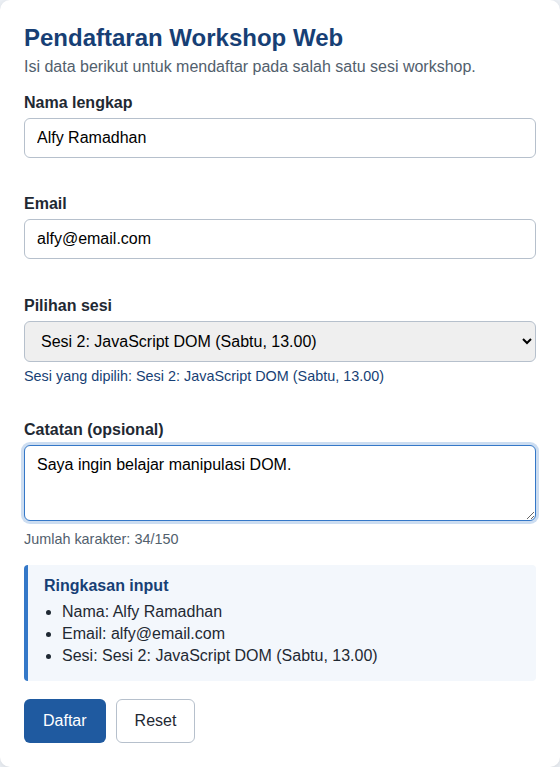

*Bukti screenshot: `mini_project_2_isian.png`*

**Kondisi valid (pendaftaran berhasil)**
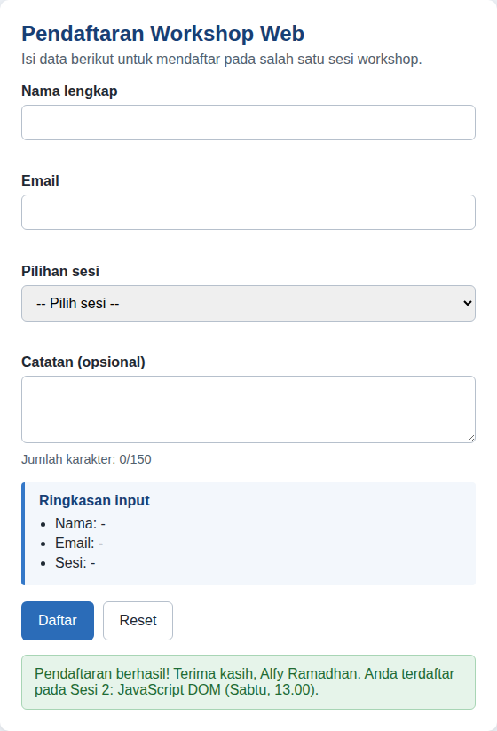

*Bukti screenshot: `mini_project_3_sukses.png`*

**Tampilan mobile (lebar 375px)**
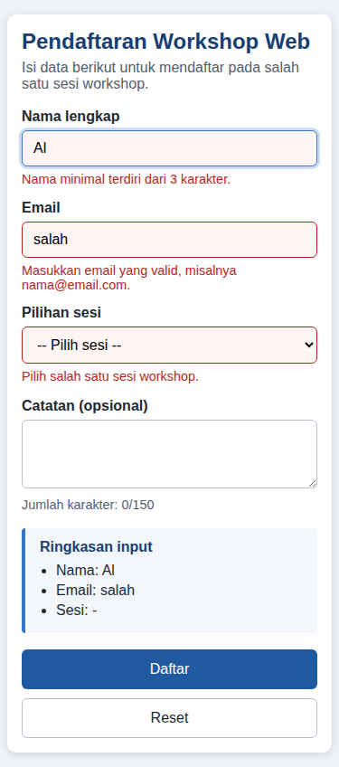

*Bukti screenshot: `mini_project_4_mobile.png`*

---

## F. Eksperimen Mandiri

### 1. Tombol hapus satu item pada To-do List
Setiap item diberi tombol *Hapus* yang memanggil `item.remove()` lalu menampilkan "Tugas dihapus.". Pada contoh, tugas "Belajar JavaScript DOM" dihapus sehingga tersisa dua tugas.
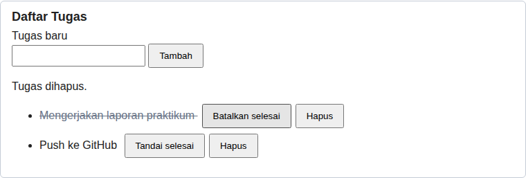

*Bukti screenshot: `eksperimen_1.png`*

### 2. Validasi nama minimal tiga karakter
Pada Latihan 5 ditambahkan cabang `else if (nama.length < 3)` dengan pesan "Nama minimal terdiri dari 3 karakter." (juga diterapkan pada Mini Project). Nama kosong tetap menampilkan "Nama wajib diisi.".
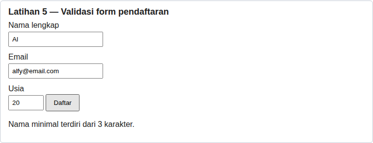

*Bukti screenshot: `eksperimen_2.png`*

### 3. Event `change` pada dropdown sesi workshop
Pada Mini Project, dropdown sesi diberi event `change` yang menampilkan "Sesi yang dipilih: ..." dan memperbarui ringkasan (lihat bagian "Pengisian dengan ringkasan" di atas).


*Bukti screenshot: `eksperimen_3.png`*

### 4. Menyembunyikan dan menampilkan paragraf dengan class CSS
Kelas `.tersembunyi { display: none; }` di-*toggle* dengan `classList.toggle("tersembunyi")`. Teks tombol berganti antara "Sembunyikan" dan "Tampilkan".
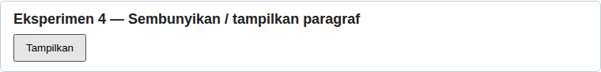

*Bukti screenshot: `eksperimen_4.png`*

### 5. Memindahkan script tanpa `defer` ke `<head>`
Dibuat dua halaman demo dengan script yang sama (`eksperimen5.js`): satu tanpa `defer` dan satu dengan `defer`.

| Halaman | Hasil |
|---------|-------|
| `eksperimen5_tanpa_defer.html` | Teks tidak berubah. Console menampilkan error: `Cannot set properties of null (setting 'textContent')` |
| `eksperimen5_dengan_defer.html` | Teks berubah menjadi "Berhasil: script menemukan elemen #hasil dan mengubah teksnya." dan tidak ada error |

**Penyebab:** script di `<head>` tanpa `defer` dijalankan saat browser membaca `<head>`, **sebelum** `<body>` diparsing. Pada saat itu elemen `#hasil` belum ada di DOM, sehingga `document.getElementById("hasil")` mengembalikan `null`. Pernyataan `null.textContent = ...` menimbulkan *TypeError* dan script berhenti. Atribut `defer` membuat script diunduh sambil HTML diparsing tetapi baru dijalankan setelah parsing selesai, sehingga elemennya sudah tersedia. Alternatif lain adalah meletakkan script di akhir `<body>` atau memakai event `DOMContentLoaded`.

**Tanpa defer (gagal)**
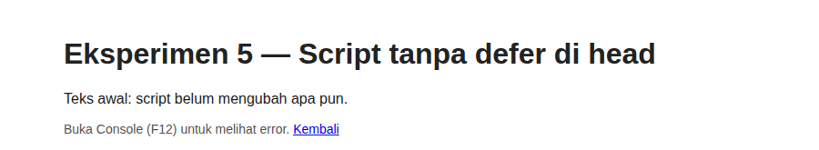

*Bukti screenshot: `eksperimen_5_tanpa_defer.png`*

**Dengan defer (berhasil)**
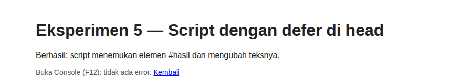

*Bukti screenshot: `eksperimen_5_dengan_defer.png`*

---

## G. Pertanyaan Evaluasi

### 1. Apa yang dimaksud dengan DOM dan apa manfaatnya?
DOM (*Document Object Model*) adalah representasi dokumen HTML dalam bentuk struktur pohon objek (*node*) yang dapat diakses dan dimanipulasi oleh JavaScript. Manfaatnya, program dapat memilih elemen, mengubah teks, atribut, kelas, dan gaya, menambah atau menghapus elemen, serta merespons tindakan pengguna sehingga halaman menjadi dinamis tanpa harus dimuat ulang.

### 2. Perbedaan `getElementById()`, `querySelector()`, dan `querySelectorAll()`
| Method | Fungsi |
|--------|--------|
| `getElementById("x")` | Memilih satu elemen berdasarkan `id`. Mengembalikan elemen atau `null`. |
| `querySelector(".x")` | Memilih **elemen pertama** yang cocok dengan selector CSS (id, class, tag, dan lainnya). |
| `querySelectorAll(".x")` | Memilih **semua** elemen yang cocok dan mengembalikannya sebagai daftar (`NodeList`) yang dapat diulang dengan `forEach`. |

### 3. Fungsi `addEventListener()` dan tiga contoh event
`addEventListener()` menghubungkan sebuah event dengan fungsi (*handler*) yang akan dijalankan saat event itu terjadi, dan satu elemen dapat memiliki beberapa listener. Contoh event: `click` (elemen diklik), `input` (isi kolom berubah saat mengetik), dan `submit` (form dikirim). Event lain misalnya `change`, `keydown`, dan `mouseover`.

### 4. Mengapa `event.preventDefault()` digunakan pada event `submit`?
Perilaku bawaan form saat dikirim adalah mengirim data dan memuat ulang halaman. `preventDefault()` membatalkan perilaku itu sehingga JavaScript dapat memeriksa data terlebih dahulu dan menampilkan pesan validasi pada halaman yang sama tanpa kehilangan isian pengguna.

### 5. Perbedaan `textContent` dan `innerHTML`
| | `textContent` | `innerHTML` |
|---|---------------|-------------|
| Penggunaan | Mengubah isi elemen sebagai **teks biasa**. | Mengubah isi elemen sebagai **markup HTML**. |
| Keamanan | Aman: karakter seperti `<` dan `>` tidak diurai menjadi tag. | Berisiko (*XSS*) jika memasukkan teks pengguna yang tidak dipercaya karena skrip atau tag di dalamnya dapat dieksekusi. |

Pada praktikum ini, masukan `<b>tebal</b>` pada To-do List tampil sebagai teks apa adanya karena memakai `textContent`.

### 6. Bagaimana `classList.toggle()` membantu mengubah tampilan elemen?
`classList.toggle("x")` menambahkan kelas `x` jika belum ada dan menghapusnya jika sudah ada. Tampilan elemen cukup diatur melalui CSS pada kelas tersebut, sehingga JavaScript hanya perlu "menyalakan" atau "mematikan" kelasnya tanpa menulis gaya satu per satu. Contohnya kelas `highlight` dan `teks-besar` pada Latihan 3, `selesai` pada To-do List, dan `tersembunyi` pada Eksperimen 4.

### 7. Skenario pengujian validasi form
| No | Skenario | Hasil yang diharapkan |
|----|----------|-----------------------|
| 1 | Semua kolom kosong | Pesan "Nama wajib diisi." |
| 2 | Nama kosong atau hanya spasi | Pesan "Nama wajib diisi." |
| 3 | Nama kurang dari 3 karakter | Pesan "Nama minimal terdiri dari 3 karakter." |
| 4 | Email tidak valid (tanpa @ atau tanpa domain) | Pesan "Masukkan email yang valid." |
| 5 | Usia di bawah 17 atau di atas 100 | Pesan "Usia harus berupa bilangan bulat 17–100." |
| 6 | Usia kosong atau desimal | Pesan "Usia harus berupa bilangan bulat 17–100." |
| 7 | Usia tepat di batas (17 dan 100) | Dinyatakan valid |
| 8 | Semua input valid | Pesan sukses dan form dikosongkan |

---

## H. Penjelasan Kode

### H.1 Alur kerja halaman
1. Browser membaca `index.html` dan menemukan `<script src="script.js" defer>` di `<head>`. Karena ada `defer`, script diunduh sambil HTML dibaca tetapi baru dijalankan **setelah** seluruh HTML selesai diparsing.
2. Saat `script.js` berjalan, kode level atas langsung mengubah teks (Latihan 1) dan **mendaftarkan event listener** pada tombol, input, dan form.
3. Fungsi di dalam listener tidak langsung berjalan. Fungsi itu baru dijalankan ketika pengguna melakukan tindakan yang cocok (klik, mengetik, mengirim form).

### H.2 Konsep utama pada `script.js`
| Bagian | Penjelasan |
|--------|-----------|
| `document.getElementById("id")` | Mengambil elemen berdasarkan `id` agar bisa dimanipulasi. |
| `textContent` | Mengganti isi teks elemen sebagai teks biasa. |
| `addEventListener("click", function () {...})` | Mendaftarkan fungsi yang dijalankan setiap event `click` terjadi. |
| `new Date().toLocaleTimeString()` | Membuat objek waktu saat ini lalu memformatnya menjadi jam. |
| `classList.toggle("x")` | Menambah atau menghapus kelas CSS sehingga tampilan berubah lewat `style.css`. |
| Event `input` + `.value.length` | Dijalankan setiap isi kolom berubah. `.value` adalah teks yang diketik dan `.length` jumlah karakternya. |
| `event.preventDefault()` | Membatalkan pengiriman dan pemuatan ulang halaman saat form disubmit. |
| `value.trim()` | Menghapus spasi di awal dan akhir sehingga isian spasi saja dianggap kosong. |
| `/^[^\s@]+@[^\s@]+\.[^\s@]+$/` | Pola email: teks tanpa spasi atau `@`, lalu `@`, lalu domain, titik, dan akhiran. |
| `Number.isInteger(usia)` | Memastikan usia bilangan bulat, sehingga 20.5 ditolak. |
| `form.reset()` | Mengosongkan semua kolom form. |
| `createElement`, `append`, `appendChild`, `remove` | Membuat elemen baru, menyusunnya, memasukkannya ke daftar, dan menghapusnya. |
| `item.classList.contains("selesai")` | Mengecek apakah kelas ada, dipakai untuk mengganti teks tombol. |

**Catatan penting:** variabel `pesan` hanya dideklarasikan satu kali (pada Latihan 1) dan dipakai ulang pada Latihan 2, karena `const` dengan nama sama tidak boleh dideklarasikan dua kali dalam satu file.

### H.3 Struktur Mini Project
- **Fungsi validasi** (`validasiNama`, `validasiEmail`, `validasiSesi`) mengembalikan teks pesan kesalahan, atau teks kosong jika valid.
- **Fungsi tampilan** (`tampilkanError`, `hapusError`, `perbaruiRingkasan`, `perbaruiHitungan`, `kosongkanTampilan`) mengurus keadaan layar, terpisah dari logika validasi.
- **Event listener** menghubungkan keduanya: `input` (nama, email, catatan), `change` (sesi), `submit` (form), dan `click` (reset).
- Seluruh teks dari pengguna ditampilkan dengan `textContent`, bukan `innerHTML`.

---

## I. Catatan
- Kode latihan mengikuti modul. Penambahan di luar modul hanya berupa halaman, gaya, dan struktur pendukung (misalnya bagian-bagian halaman dan CSS).
- Halaman `eksperimen5_*.html` dan `eksperimen5.js` dibuat khusus untuk mendemonstrasikan Eksperimen 5 secara terpisah dari halaman utama, supaya error yang disengaja tidak mengganggu latihan lain.
- Screenshot diambil dari halaman yang dijalankan di browser. Pesan error Eksperimen 5 dicatat dari Console.
